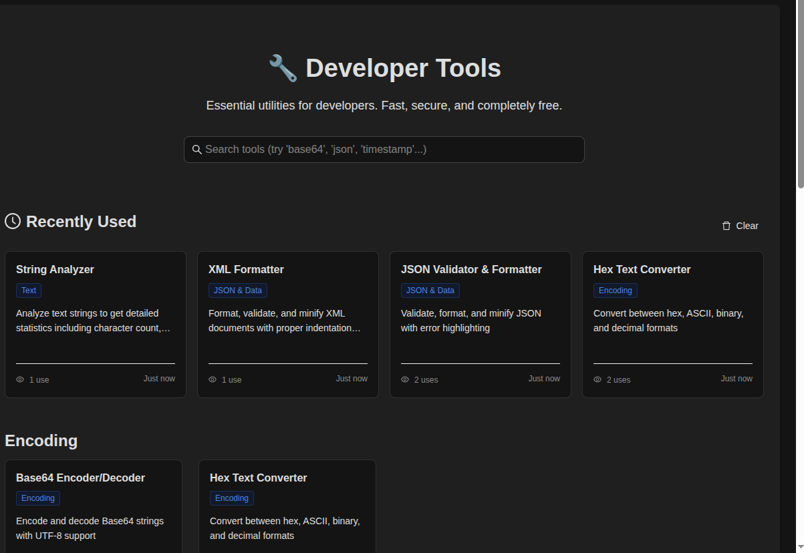
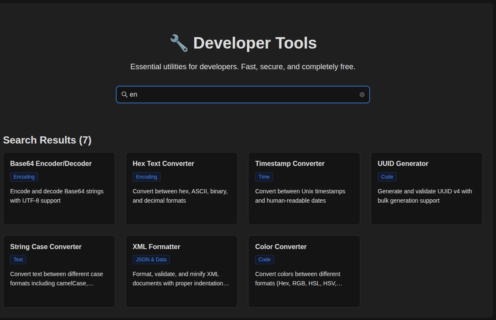
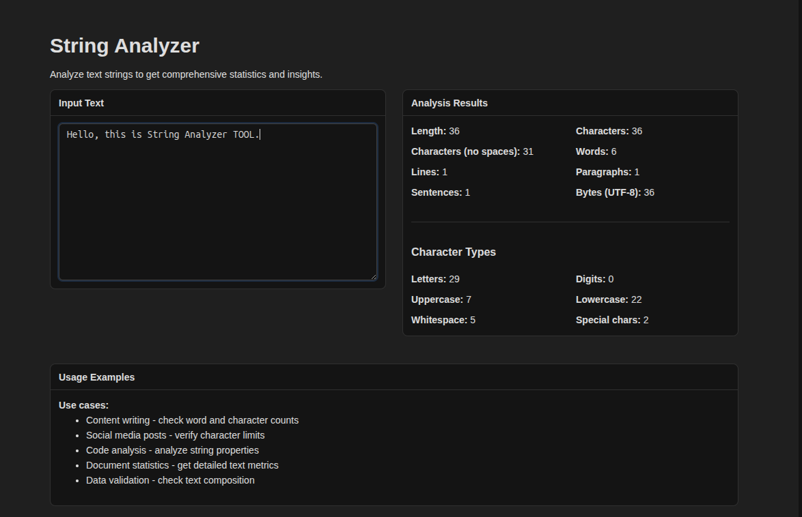
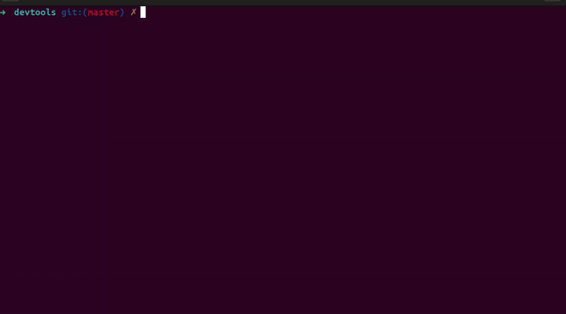

# 🔧 DevTools - Common Developer Utilities CLI and Web

A comprehensive collection of essential developer tools built with React and TypeScript. Available as both a web application and command-line interface.


## 🌟 Features

- **🎨 Modern Web Interface** - Clean, responsive design with dark/light theme support
- **⚡ Fast & Lightweight** - Built for performance with minimal dependencies
- **🔧 CLI Interface** - Use all tools directly from your terminal
- **📱 Cross-Platform** - Works on any device with a modern web browser
- **🛠️ Developer-Focused** - Built by developers, for developers

### Screenshots

|                                  |                                  |                                  |
| :--------------------------------: | :--------------------------------: | :--------------------------------: |
|    |    |    |
| *Web Interface* | *Search* | *Tool Example* |

### CLI in Action


## 🚀 Quick Start

### Web Interface

Visit [devtools.anvik.studio](https://devtools.anvik.studio) to start using DevTools immediately.

### CLI Installation

```bash
npm install -g @devtools-cli/devtools-cli
devtools --help
```

## 📚 Available Tools

### 🔐 Encoding Tools

- **[Base64 Encoder/Decoder](wiki/Base64-Encoder-Decoder.md)** - Encode/decode Base64 with UTF-8 support
- **[Hex Text Converter](wiki/Hex-Text-Converter.md)** - Convert between hex, ASCII, binary, decimal

### 📊 JSON & Data Tools

- **[JSON Validator & Formatter](wiki/JSON-Validator-Formatter.md)** - Validate, format, minify JSON
- **[XML Formatter](wiki/XML-Formatter.md)** - Format, validate, minify XML documents

### 📝 Text Tools

- **[String Analyzer](wiki/String-Analyzer.md)** - Analyze text with detailed statistics
- **[String Case Converter](wiki/String-Case-Converter.md)** - Convert between case formats
- **[Text Diff Tool](wiki/Text-Diff-Tool.md)** - Compare and visualize text differences

### ⏰ Time Tools

- **[Timestamp Converter](wiki/Timestamp-Converter.md)** - Convert Unix timestamps & ISO dates
- **[Cron Expression Parser](wiki/Cron-Expression-Parser.md)** - Parse and explain cron expressions

### 💻 Code Tools

- **[UUID Generator](wiki/UUID-Generator.md)** - Generate UUID v4 identifiers
- **[Color Converter](wiki/Color-Converter.md)** - Convert colors & analyze accessibility

## 📖 Documentation

Each tool has comprehensive documentation in the [wiki](wiki/) folder:

- **Key Features** - Important functionality highlights
- **Web UI Guide** - Step-by-step usage instructions
- **CLI Usage** - Command-line examples and options

For version history and release notes, see the [CHANGELOG.md](CHANGELOG.md).

## 🏗️ Project Structure

```
devtools/
├── apps/
│   ├── web/              # React web application
│   └── cli/              # Command-line interface
├── packages/
│   └── core/             # Shared business logic
├── wiki/                 # Tool documentation
└── docs/                 # Project documentation
```

## 🛠️ Development

### Prerequisites

- Node.js 18+
- npm or yarn

### Setup

```bash
# Clone the repository
git clone https://github.com/abhishekbansal/devtools.git
cd devtools

# Install dependencies
npm install

# Start development server
npm run dev

# Build for production
npm run build
```

### CLI Development

```bash
# Build CLI
npm run build:cli

# Test CLI locally
node packages/cli/bin/devtools --help
```

## 📦 Deployment

### Web App

The web application automatically deploys to GitHub Pages when changes are pushed to the master branch.

```bash
# Manual build and deploy
cd apps/web
pnpm run build
pnpm run deploy
```

### CLI Package

```bash
# Build and publish CLI
cd packages/cli
npm publish
```

## 🤝 Contributing

Contributions are welcome!

1. Fork the repository
2. Create a feature branch
3. Make your changes
4. Add tests if applicable
5. Submit a pull request

## 📄 License

This project is licensed under the MIT License - see the [LICENSE](LICENSE.MD) file for details.

## 🙏 Acknowledgments

- Built with [React](https://reactjs.org/) and [TypeScript](https://www.typescriptlang.org/)
- UI components from [Ant Design](https://ant.design/)
- CLI built with [Commander.js](https://github.com/tj/commander.js)

## 📞 Support

- 🐛 **Issues**: [GitHub Issues](https://github.com/abhishekbansal/devtools/issues)
- 💬 **Discussions**: [GitHub Discussions](https://github.com/abhishekbansal/devtools/discussions)

---

**Made with ❤️ by [Abhishek Bansal](https://github.com/abhishekbansal)**
